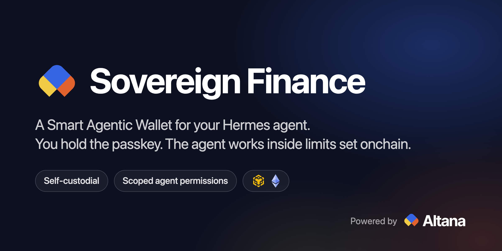

# Sovereign Finance



A Hermes plugin that gives your agent a Smart Agentic Wallet, powered by [Altana](https://altana.network), on BNB Chain and Ethereum.

You hold the admin key, and it is a passkey. It stays on your device, and every admin action needs your fingerprint. The agent holds a session key. The wallet contract limits that key to the contracts, functions and daily amounts you approved, until the date you set, and you can revoke it whenever you like.

Inside those limits the agent can provide liquidity on PancakeSwap V3 and Uniswap V3 and rebalance it on a Hermes cron job.

## What has been run

| Network | Checked with a real passkey |
|---|---|
| BNB Chain | Create the wallet, activate, open a position from chat, a transfer outside the scope refused by the wallet, close, revoke, withdraw. |
| BNB testnet | The same, plus a rebalance from Hermes cron. |
| Sepolia | The same, including the cron rebalance. Activation takes more approvals there (see below). |
| Ethereum | Not verified. The wallet has the same address there, but an activation did not confirm during testing. Start on BNB Chain. |

## Install

One click from Hermes Desktop:

```
hermes://plugin/install?repo=gabonaut/hermes-sovereign-finance&enable=1
```

Or from a terminal:

```
hermes plugins install gabonaut/hermes-sovereign-finance
hermes plugins enable sovereign-finance
```

Then switch on Sovereign Finance under Capabilities > Plugins in Hermes Desktop.

You need Hermes 0.23.0 or newer, Hermes Desktop, macOS or Linux, and a browser with passkeys.

## Set up the wallet

The pane has four steps. Nothing is sent to a chain until step 4.

1. **Create Smart Agentic Wallet.** Your browser opens a page on localhost and creates a passkey. The wallet has one address on both networks.
2. **Fund.** Send the native coin to that address from your own wallet: ETH on Ethereum, BNB on BNB Chain.
3. **Set permissions.** Pick the tokens the agent may use, a daily cap for each, a daily cap for the native coin, and how many days the session lasts. The pane shows the resulting scope in plain English and what activation costs.
4. **Activate.** One passkey approval per network, three or four on Sepolia. On mainnet, approve within 30 seconds of the passkey button appearing: the relay's fee quote lasts that long, and a late approval sends nothing. The first activation on a network also deploys the wallet there and registers two keys in the Altana Keystore, at $0.50 each. Later activations register one.

After that the pane shows, per network, the session's scope and expiry, open positions, a link to the session key in the Keystore explorer, and Revoke. Withdraw sends funds from the wallet to an address you type. It needs your passkey too.

Testnet mode (BNB testnet and Sepolia) is the default. Mainnet mode uses a separate wallet with its own passkey.

One wallet is in use per mode. "Use another wallet" in step 1 sets the current one aside and lets you create or recover another. A wallet set aside keeps its funds, its positions and any session you have not revoked, and its records stay on disk. Pick it under Earlier wallets, or use Recover from passkey, to return to it.

Sepolia limits how much new storage one transaction can write to the wallet, so activation takes three passkey approvals there instead of one, plus one more the first time, which sets the wallet up on Sepolia. The pane shows the count before you confirm. Everything else works the same on both testnets.

## What the agent gets

| Tool | What it does |
|---|---|
| `sovereign_status` | Address, balances, session status, scope and caps. Read-only. |
| `sovereign_positions` | Positions with range, in-range flag, amounts and unclaimed fees. Read-only. |
| `sovereign_quote` | The most traded V3 pools with fee APR, swap quotes, and plans that open or close a position. Read-only. |
| `sovereign_execute` | Sends one batch with the session key. `open` or `close` builds the whole batch for a position; a `planId` from a quote runs that plan. |
| `sovereign_skill` | Reads skills from the Altana skills registry after checking their hash. Read-only. |

There is no tool for creating a wallet, changing permissions, activating, revoking or withdrawing. Those exist only in the pane, and each needs your passkey.

`/sovereign` prints the same status as a plain card without a model turn.

The bundled skill `sovereign-finance:v3-range` teaches the agent the plays: list pools, size a range, enter, check the range, rebalance, collect fees.

## What holds the agent back

**The wallet contract, onchain.** With the V3 LP preset the session key may call only these functions: `exactInputSingle` on the DEX router; `mint`, `increaseLiquidity`, `decreaseLiquidity`, `collect` and `burn` on the position manager; `deposit`, `withdraw` and `approve` on the wrapped native token; `approve` on each token you ticked. Each token has a daily cap, the native cap also pays relay fees, and approvals are cleared when a batch ends. Any other call is refused with `UnauthorizedCall` before it is sent. After a revoke the wallet no longer accepts the key, and the session ends on its expiry date.

**The plugin, before signing.** The plugin encodes every action itself. The wallet is the recipient of every swap, mint and collect, approvals are exact amounts to the router or the position manager, and a position must belong to the wallet.

**Hermes, before sending.** Every `sovereign_execute` call asks for your approval with a sentence decoded from the encoded batch. "Always" covers later batches for the same pool on the same network, for the current session key only.

### Limits

- The session scope names contracts, functions and daily amounts. It does not look at a call's other arguments, which is why the plugin sets every recipient itself. Keep the session key file private, and revoke the session if the machine is shared or the file may have been copied.
- The guard hook is a text check on other tools' arguments, not a sandbox. The onchain session scope is what bounds the agent, and the passkey is yours to look after like any self-custodial key.
- Hermes YOLO mode, `approvals.mode: off` and `approvals.cron_mode: approve` skip the approval prompt. The onchain limits still apply.
- If you lose every copy of the passkey, nobody can revoke or withdraw. The session still ends on its expiry date.
- The wallet's networks are fixed when it is created.
- Setting a wallet aside changes which wallet the plugin uses. It does not revoke that wallet's session.
- Revoke removes the agent's key and nothing else. An open position stays in the wallet. To exit, have the agent close it first, then withdraw, then revoke.
- Every transaction goes through the Altana relay, including a withdrawal signed by your passkey. Funds on a network wait for the relay to deliver there.
- The passkey page is on localhost, and the passkey is bound to that name. Approve only a prompt you started from the pane.
- Hermes loads plugin tools on demand. A capable model finds them from a plain request; a small one may need the tool named, as in "use sovereign_execute".

## Run it

Ask in chat, for example:

> Show me the most traded V3 pools on BNB Chain. Then put 0.02 BNB into the one I pick, 1% either side of the price.

The agent lists the pools with volume, TVL and fee APR. You choose, and Hermes asks you to approve the batch.

Each active network in the pane also has an "Ask the agent" block: Find a pool, Open a position, Keep it in range, Compound fees and Cash out. A button writes the request into the chat box and you send it. The plays are a short list in `pane/src/plays.ts`; add an entry there to offer your own.

### Rebalance on cron

```
hermes cron create "30m" "Check my Sovereign Finance positions on bnb and ethereum. If one is out of range, close it and reopen it around the current price, following the v3-range skill. Otherwise answer with one line of status." --name v3-range-keeper --skill sovereign-finance:v3-range
```

Cron runs unattended, so Hermes blocks anything you have not approved in advance. Approve one batch for the pool in chat and choose Always. Later batches for that pool then run from cron, and everything else is still blocked. An "Always" answer stops matching when the session is revoked or replaced. A "session" answer does not carry into cron.

## Disclosure

- **Network.** The plugin talks to the Altana relay (`relay.altana.network`, `testnet-relay.altana.network`), public RPC endpoints on `publicnode.com`, the DexScreener API for the mainnet pool list, and `skills.altana.network` when the agent asks for a registry skill. No telemetry.
- **Processes.** Each command starts the bundled Node CLI with Hermes's Node, or the `node` on your PATH. During a wallet admin action the CLI serves one page on `localhost`, on a random port and path, for the passkey prompt, and exits when the action ends.
- **Stored on disk.** `~/.hermes/plugin-data/sovereign-finance/`, mode 0700: the session keys in plain files (mode 0600, because cron signs unattended), the passkey's public handle, session scopes, caches, and the same records for wallets set aside. The admin key is never on disk.
- **Hooks.** A `pre_tool_call` hook reads the arguments of every tool call. It blocks calls that name the plugin's key files, CLI or admin routes, and it turns `sovereign_execute` into an approval prompt.
- **Backend routes.** `dashboard/plugin_api.py` answers only the local Hermes Desktop app.
- **Bundled code.** `cli/dist/sovereign.mjs` and `desktop/plugin.js` are built from `cli/` and `pane/`. `scripts/verify-build.sh` rebuilds both from the lockfiles and fails on any difference.
- **Registry skills** are text the agent reads. One loads only if its sha256 matches both the registry index and the hash pinned in `networks.json`.

## Development

```
cd cli && npm ci && npm test && node build.mjs
cd pane && npm ci && node build.mjs
uv run --no-project --with fastapi --with httpx --with pyyaml python -m unittest discover -s tests
hermes plugins validate .
```

`cli/dev/run.ts` runs the same commands with a software authenticator for testnet work. It refuses mainnet.

The CLI reads its JSON input from stdin. When you run it by hand, pipe the input in, or add `< /dev/null` for a command that takes none.

## License

MIT. `skills/v3-range/SKILL.md` is GPL-3.0, the license the Altana skills registry uses for skill content.
